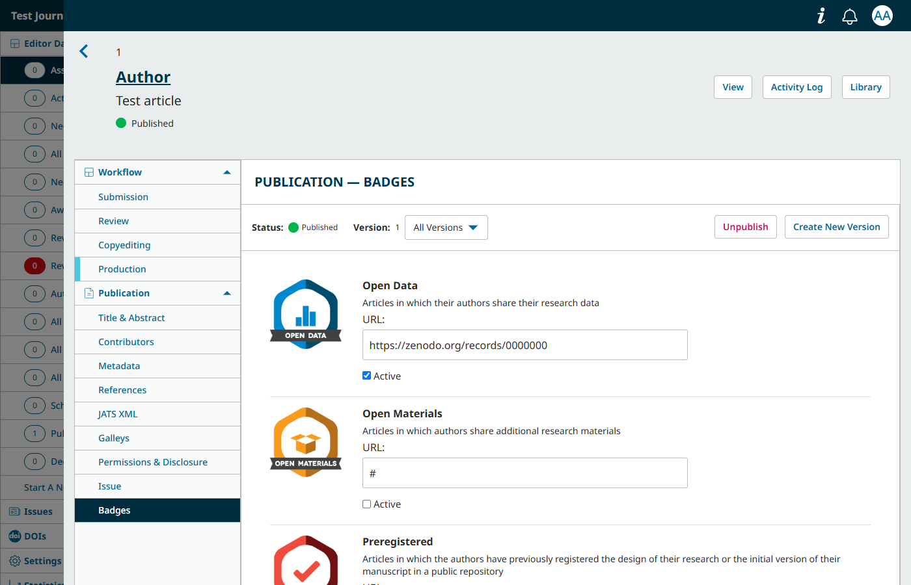
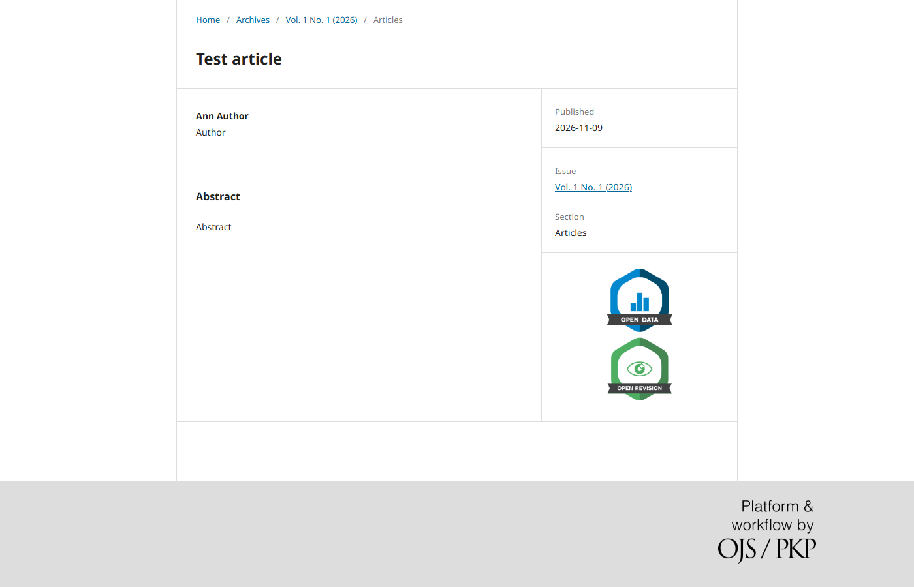

# openbadges
#### Open Science Badges Plugin for OJS

What are open science badges? It is a system by which researchers are intended to share the raw results of their research.

We take the Anglo-Saxon example as a model, where they have been operating for years:
* [Open Science Badges enhance openness, a core value of scientific practice](https://www.cos.io/initiatives/badges)
* [Badges to Acknowledge Open Practices Wiki](https://osf.io/tvyxz/wiki/home/)

You can also see how a major academic publisher works with its Open Science Badges system:
* [Wiley Open Practices](https://authorservices.wiley.com/open-research/open-practices/index.html)

## Badges types:
* Open Data (The Open Data badge is awarded when digitally-shareable data necessary to reproduce the reported results are publicly available)
* Open Materials (The Open Materials badge is earned by making publicly available the components of the research methodology needed to reproduce the reported procedure and analysis)
* Preregistered (The Preregistered badge is earned when the authors have previously registered the design of their research or the initial version of their manuscript in a public repository)
* Open Revision

### Improvements/Features/Corrections:
* [x] Add logic for doesn't load badge block in submission when there are no badges assigned
* [ ] Settings form to manage badges
* [x] Language implementation
  * [x] Badge image for each language
* [x] Security
* [ ] Option for upload/modify badge images
* [ ] Window/alert confirmation for delete database registers when module is disabled
  * [ ] Review plugin lifecycle
* [x] Modify default url and add blank page
* [x] Metadata -> tag <openbadges> value: openscience </openbadges>
  * [x] Include this value in settings table (badge_settings)
* [x] Validate urls:(www.sample.web)
* [x] Add badges in submission/articles list view
* [x] Translate repo

## Installation (OJS 3.5)
1. Copy this folder to `plugins/generic/openbadges` (the folder name must stay lowercase: OJS derives the class name `OpenbadgesPlugin` from it).
2. Create the database tables with `php lib/pkp/tools/installPluginVersion.php plugins/generic/openbadges/version.xml` (or run the OJS upgrade). If this step is skipped, the plugin creates the tables itself the first time it is enabled.
3. Enable it in *Settings > Website > Plugins > Generic Plugins*.

You can also upload the `.tar.gz` of a [release](https://github.com/Glaux-PA/openbadges/releases) in *Settings > Website > Plugins > Upload a New Plugin*.

## Branches and releases

| OJS | Branch | Release |
|---|---|---|
| 3.5 | `main`, `stable-3_5_0` | 1.2.0.0 |
| 3.4 | `stable-3_4_0` | 1.1.0.0 |
| 3.3 | `stable-3_3_0` | 1.0.0.4 |

## Usage
* Open the submission in the editorial dashboard and go to **Publication** > **Badges**.
* Tick **Active** on each badge the article has earned and, optionally, set the URL where the evidence is published. The URL must start with `http://` or `https://`; otherwise `#` is used.
* Press **Save**. Authors can also do it for their own submissions from their dashboard.

Only the badges awarded to an article are stored: a row is saved when a badge is activated and removed when it is deactivated.

## License

This plugin is distributed under the GNU GPL v3. For full terms see the file [LICENSE](LICENSE).
